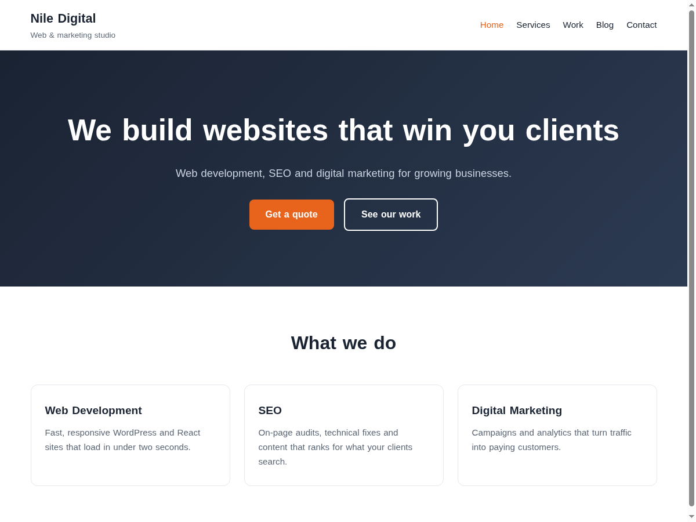

# Cairo Starter - WordPress Theme

A lightweight business/portfolio WordPress theme written from scratch: no frameworks, no page-builder lock-in, no jQuery. Hero section, services grid and portfolio loop are built in, and the accent color and hero copy are editable from the Customizer.

**[Project page](https://amr3492.github.io/cairo-starter-theme/)** - features, screenshot and install guide.

## Features

- **Front page that sells out of the box**: hero with editable heading/subheading/button, a "What we do" services grid (pages using the *Service* template appear automatically), a recent-work portfolio grid, and a contact call-to-action.
- **Customizer-first**: accent color (injected as a CSS variable) and all hero copy under *Appearance > Customize*.
- **Full template set**: `front-page`, `index`, `single`, `page`, `archive`, `search`, `404`, `comments`, plus a `Service` page template and reusable template parts.
- **Registered areas**: primary + footer menus, one blog sidebar, three footer widget columns.
- **Modern WP support**: custom logo, post thumbnails, HTML5 markup, responsive embeds, wide alignments, translation-ready (`cairo-starter` text domain), skip-link and ARIA-labelled navigation.
- **Responsive**: CSS-grid layouts collapse cleanly; mobile menu toggle is 20 lines of vanilla JS.
- **Core classes covered**: `.alignleft/right/center`, `.wp-caption`, `.sticky`, `.bypostauthor`, galleries, pagination.

## Install

1. Download or clone this repo.
2. Zip the folder (or upload it directly) under *Appearance > Themes > Add New > Upload Theme*.
3. Activate **Cairo Starter**.
4. Set a static front page under *Settings > Reading* to get the full business layout.
5. Create up to three pages with the **Service** template - they show up in the front-page grid automatically.

## Customize

| Setting | Where |
| --- | --- |
| Accent color | Customize > Colors |
| Hero heading, subheading, button label/link | Customize > Front Page Hero |
| Logo | Customize > Site Identity |
| Menus | Customize > Menus (Primary, Footer) |
| Widgets | Customize > Widgets (Blog Sidebar, Footer 1-3) |

## Requirements

- WordPress 6.0+, PHP 7.4+

## License

GPL v2 or later, matching WordPress. See [LICENSE](LICENSE).
